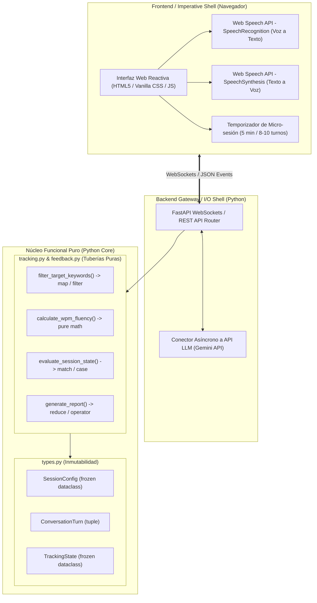

# Especificaciones Técnicas y de Arquitectura
## Proyecto: Hi Learning (Plataforma Conversacional de Práctica de Inglés con IA)

---

## 1. Resumen Ejecutivo del Proyecto

- **Nombre del Proyecto:** Hi Learning
- **Contexto Académico:** Universidad de Colima — Facultad de Ingeniería Mecánica y Eléctrica (FIME).
- **Materia:** Programación Funcional (3º Semestre - ICI). Ponderación del proyecto: **50% de la calificación final**.
- **Problema a Resolver:** Superar el "efecto embudo" en el aprendizaje del idioma inglés, donde hasta un 80% de los estudiantes con comprensión intermedia (B1) no logran producir lenguaje oral espontáneo por miedo al error, falta de confianza y ausencia de entornos de práctica activa.
- **Propuesta de Valor:** Micro-sesiones interactivas de conversación de 5 minutos (8 a 10 turnos) con un agente de IA que asume roles realistas (ej. entrevistas de trabajo, viajes, charlas cotidianas), adaptando el nivel (A1-C2) y monitoreando en segundo plano el uso de vocabulario objetivo sin interrupciones punitivas, entregando un reporte final con métricas y retroalimentación constructiva.

---

## 2. Arquitectura de Software

La arquitectura adoptada es **Functional Core, Imperative Shell (FCIS)** combinada con el patrón **Pipes & Filters (Tuberías de Datos)**.



### Separación de Responsabilidades:
1. **Imperative Shell (Capa Externa / Efectos Secundarios):** Maneja audio, eventos del navegador, WebSockets, llamadas HTTP a la API del LLM y almacenamiento.
2. **Functional Core (Capa Interna / Lógica Pura):** No tiene dependencias externas ni efectos secundarios. Recibe datos inmutables y retorna nuevos estados y reportes calculados de forma 100% determinista.

---

## 3. Stack Tecnológico Recomendado

### 3.1 Frontend (Cliente / Interfaz de Usuario)
| Componente | Tecnología Seleccionada | Justificación Técnica |
| :--- | :--- | :--- |
| **Estructura** | **HTML5 Semántico** | Accesibilidad, rendimiento óptimo y carga instantánea. |
| **Estilos** | **Vanilla CSS Moderno** | Control total de diseño, soporte para *Dark Mode*, efecto *Glassmorphism*, variables CSS y micro-animaciones fluidas sin dependencias externas pesadas. |
| **Lógica** | **JavaScript ES6+ Nativo** | Manipulación limpia del DOM, gestión del temporizador y conexión por WebSockets. |
| **Reconocimiento de Voz (STT)** | **Web Speech API (`SpeechRecognition`)** | Conversión nativa de voz a texto en el navegador del estudiante en tiempo real con cero costo de API. |
| **Síntesis de Voz (TTS)** | **Web Speech API (`SpeechSynthesis`)** | Reproducción oral con acentos naturales en inglés (US/UK) sin latencia de red ni librerías de audio externas. |

### 3.2 Backend & Gateway (Servidor y API)
| Componente | Tecnología Seleccionada | Justificación Técnica |
| :--- | :--- | :--- |
| **Lenguaje** | **Python 3.10+** | Lenguaje oficial del curso con soporte para *Structural Pattern Matching*, tipado estricto y herramientas funcionales. |
| **Framework Web** | **FastAPI + Uvicorn** | Servidor asíncrono de alto rendimiento, soporte nativo de WebSockets para comunicación bidireccional en tiempo real y documentación automática (OpenAPI). |
| **Motor de IA (LLM)** | **Google Gemini API** (`google-genai` / SDK) | Excelente capacidad conversacional en inglés, baja latencia para respuestas por turnos y generación estructurada de retroalimentación en JSON. |

### 3.3 Núcleo Funcional (Python Core — 50% Evaluación de Materia)
| Módulo / Característica | Concepto Funcional Aplicado | Implementación en el Proyecto |
| :--- | :--- | :--- |
| **Modelos de Datos** | Inmutabilidad y Tipado Estricto | `dataclasses` con `frozen=True` y `NamedTuple` para evitar mutaciones de estado durante la sesión. |
| **Procesamiento de Turnos** | Funciones Puras | Transformaciones de texto y análisis sin variables globales ni efectos secundarios. |
| **Tubería de Vocabulario** | Funciones de Alto Orden (HOF) | Uso de `map()`, `filter()`, `reduce()` y el módulo `operator` para rastrear palabras clave usadas vs pendientes. |
| **Flujo Conversacional** | Generadores (`yield`) | Transmisión eficiente de turnos y tokens de conversación en streaming sin saturar la memoria. |
| **Métricas y Telemetría** | Decoradores de Función | Decoradores para validación de contratos de entrada y medición de latencia de respuestas. |
| **Clasificación de Eventos** | *Pattern Matching* (`match/case`) | Máquina de estados declarativa para gestionar las fases de la micro-sesión (Inicio, Conversación, Último Minuto, Finalizado). |

---

## 4. Requerimientos Funcionales y Flujo Operativo

```text
[1. Configuración] ──► [2. Conversación Inmersiva] ──► [3. Tracking Silencioso] ──► [4. Feedback Final]
 (Tema, Nivel,          (Voz/Texto, Rol de IA,          (Monitoreo en 2º plano       (Reporte estructurado,
  Vocabulario)           5 min / 8-10 turnos)            de palabras clave)           cobertura %, fluidez PPM)
```

1. **Pantalla de Configuración Inicial:**
   - Selección de tema contextual (ej. *Job Interview*, *At the Airport*, *Coffee Shop*).
   - Definición del nivel de inglés (A1, A2, B1, B2, C1, C2).
   - Inyección de vocabulario o gramática objetivo a practicar.
2. **Sala de Conversación Inmersiva:**
   - Modo dual: Entrada por **micrófono (voz)** o teclado (texto).
   - Temporizador dinámico de 5 minutos con barra de progreso de turnos.
   - Rol adaptativo del agente: la IA formula preguntas abiertas y estimulantes, ofreciendo pistas si el alumno se bloquea, sin cortar la fluidez con correcciones inmediatas.
3. **Evaluación en Segundo Plano (Tracker Funcional):**
   - Rastrear qué palabras clave del vocabulario objetivo han sido utilizadas correctamente.
   - Cálculo en tiempo real de métricas de producción oral (Palabras Por Minuto - PPM).
4. **Dashboard de Retroalimentación:**
   - Porcentaje de cobertura de vocabulario alcanzado.
   - Resumen de puntos fuertes y correcciones gramaticales constructivas (Texto emitido vs. Forma natural nativa).

---

## 5. Estructura de Carpetas del Repositorio

```text
proyecto/
├── bitacora_de_estudio.md          # Bitácora obligatoria con registro de prompts
├── plan_materia.md                 # Planeación académica del curso
├── proyecto.md                     # Definición de requerimientos iniciales
├── especificaciones.md             # Este documento de especificaciones técnicas
├── client/                         # FRONTEND (Imperative Shell)
│   ├── index.html                  # Vistas: Configuración, Chat Inmersivo y Feedback
│   ├── styles.css                  # Sistema de diseño, Dark Mode y Glassmorphism
│   ├── speech.js                   # Módulo de Web Speech API (STT y TTS)
│   └── app.js                      # Orquestador cliente y conexión WebSocket
├── server/                         # BACKEND (I/O Shell)
│   ├── main.py                     # Servidor FastAPI y WebSocket Router
│   ├── config.py                   # Variables de entorno y llaves API
│   └── llm_service.py              # Cliente de integración con Gemini API
├── core/                           # NÚCLEO FUNCIONAL PURO (Python)
│   ├── __init__.py
│   ├── types.py                    # Frozen Dataclasses y modelos inmutables
│   ├── prompt_builder.py           # Ensamblador puro de prompts para roles
│   ├── tracking.py                 # Tubería de vocabulario y fluidez (map, filter, reduce)
│   ├── generators.py               # Generadores de turnos y streaming (yield)
│   ├── decorators.py               # Decoradores de medición y validación
│   └── feedback.py                 # Generador de reportes mediante Pattern Matching
└── tests/                          # SUITE DE PRUEBAS UNITARIAS
    ├── test_tracking.py            # Pruebas de funciones puras e inmutabilidad
    └── test_feedback.py            # Pruebas del generador de reportes
```

---

## 6. Fases de Implementación

- [x] **Fase 0: Definición y Especificación:** Requisitos consolidados, análisis de plan de estudios y arquitectura FCIS definida.
- [ ] **Fase 1: Núcleo Funcional Puro:** Implementación de `core/types.py`, `core/tracking.py` y suite de pruebas unitarias con `assert`.
- [ ] **Fase 2: Cliente Web MVP:** Creación de `client/index.html`, `styles.css` con reconocimiento de voz (Web Speech API) y temporizador de 5 minutos.
- [ ] **Fase 3: Backend FastAPI y Conector LLM:** Integración de WebSockets en `server/main.py` y llamadas asíncronas a Gemini API.
- [ ] **Fase 4: Integración Completa y Dashboard:** Enlace del flujo completo y generación del reporte de retroalimentación final.
