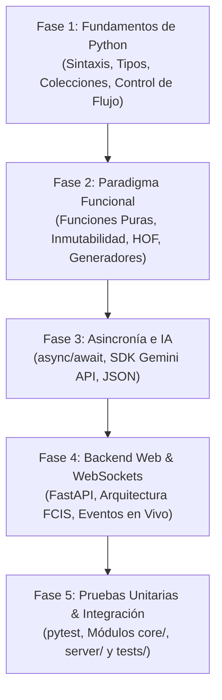

# Guía Maestra de Python: Desde Cero hasta el Backend de Hi Learning

> **Propósito:** Esta guía está diseñada para llevarte desde los conceptos más básicos de Python hasta el dominio de las herramientas necesarias para construir el backend y el núcleo funcional del proyecto **Hi Learning**, asegurando al mismo tiempo el máximo aprovechamiento académico en la materia de **Programación Funcional**.

---

## 🗺️ Mapa de Ruta General (Roadmap por Fases)



---

## 📌 Fase 1: Fundamentos Absolutos de Python (Bases Sólidas)
**Objetivo:** Dominar la sintaxis básica, los tipos de datos y el flujo de control sin sobrecargar la memoria con conceptos innecesarios.

### 1.1 Variables, Tipos Primitivos y Tipado
Python es de tipado dinámico, pero para proyectos profesionales y programación funcional usamos **Type Hints** (anotaciones de tipo).

```python
# Tipos primitivos básicos
tema_conversacion: str = "Job Interview"
nivel_estudiante: str = "B1"
duracion_segundos: int = 300
palabras_por_minuto: float = 85.5
sesion_activa: bool = True

print(f"Sesión sobre '{tema_conversacion}' iniciada para nivel {nivel_estudiante}.")
```

### 1.2 Estructuras de Datos Fundamentales
| Estructura | Mutabilidad | Uso en Hi Learning |
| :--- | :--- | :--- |
| **Listas `[]`** | Mutable | Colecciones dinámicas de mensajes de chat. |
| **Tuplas `()`** | Inmutable | Pares de datos fijos (ej. `(palabra, conteo)`, `(timestamp, texto)`). |
| **Diccionarios `{}`** | Mutable | Payloads JSON recibidos desde el frontend. |
| **Sets `{}`** | Mutable (único) | Lista de vocabulario objetivo para búsquedas instantáneas $O(1)$. |

```python
# Vocabulario objetivo como un Set (conjunto inmutable de palabras clave únicas)
target_vocab: set[str] = {"experience", "skills", "teamwork", "leadership"}

# Tupla de un turno conversacional: (hablante, mensaje, duracion_seg)
primer_turno: tuple[str, str, float] = ("user", "I have great leadership skills", 4.2)
```

### 1.3 Control de Flujo y Pattern Matching Moderno (Python 3.10+)
En lugar de cadenas largas de `if/elif`, Python 3.10 introdujo `match / case`, una herramienta central en programación funcional.

```python
def evaluar_estado_sesion(turnos_completados: int, tiempo_restante_seg: int) -> str:
    match (turnos_completados, tiempo_restante_seg):
        case (_, 0):
            return "TIEMPO_AGOTADO"
        case (t, _) if t >= 10:
            return "LIMITE_TURNOS_ALCANZADO"
        case (_, seg) if seg <= 60:
            return "FASE_CIERRE_ULTIMO_MINUTO"
        case _:
            return "EN_PROGRESO"

print(evaluar_estado_sesion(8, 45))  # Retorna: FASE_CIERRE_ULTIMO_MINUTO
```

---

## 📌 Fase 2: Paradigma Funcional Aplicado (Núcleo de Hi Learning)
**Objetivo:** Desarrollar el **Functional Core** requerido para el 50% de la calificación de la materia.

### 2.1 Inmutabilidad Estricta con `dataclasses(frozen=True)`
Para evitar bugs de concurrencia y mutaciones accidentales del estado conversacional.

```python
from dataclasses import dataclass

@dataclass(frozen=True)
class SessionConfig:
    topic: str
    target_level: str
    target_keywords: tuple[str, ...]
    max_duration_seconds: int = 300

# Creación inmutable
config = SessionConfig(
    topic="At the Airport",
    target_level="A2",
    target_keywords=("passport", "boarding pass", "flight", "luggage")
)

# Intentar modificar 'config.topic = "Hotel"' lanzará un FrozenInstanceError
```

### 2.2 Funciones Puras y Tuberías de Transformación
Una función pura siempre produce la misma salida para la misma entrada y no modifica nada fuera de sí misma.

```python
import string

def clean_and_tokenize(text: str) -> list[str]:
    """Función pura: Limpia puntuación y divide el texto en palabras."""
    translator = str.maketrans('', '', string.punctuation)
    clean_text = text.translate(translator).lower()
    return clean_text.split()

def find_used_keywords(words: list[str], target_keywords: set[str]) -> set[str]:
    """Función pura: Identifica qué palabras clave fueron utilizadas."""
    return set(words).intersection(target_keywords)

# Prueba pura:
texto_usuario = "Here is my passport and my boarding pass!"
palabras = clean_and_tokenize(texto_usuario)
usadas = find_used_keywords(palabras, {"passport", "boarding pass", "luggage"})
print("Palabras utilizadas:", usadas)  # {'passport'}
```

### 2.3 Funciones de Alto Orden (HOF): `map`, `filter`, `reduce` y List Comprehensions
```python
from functools import reduce
import operator

turnos_palabras: list[int] = [12, 18, 25, 14, 20]  # Palabras por turno

# 1. filter: Filtrar turnos con alta producción oral (> 15 palabras)
turnos_altos = list(filter(lambda x: x > 15, turnos_palabras))

# 2. map: Convertir conteo de palabras a estimación de segundos (asumiendo 2.5 palabras/seg)
duracion_estimada = list(map(lambda words: round(words / 2.5, 2), turnos_palabras))

# 3. reduce: Sumar el total de palabras habladas
total_palabras = reduce(operator.add, turnos_palabras, 0)

print(f"Turnos altos: {turnos_altos}")
print(f"Duración estimada por turno: {duracion_estimada}")
print(f"Total palabras: {total_palabras}")
```

### 2.4 Generadores (`yield`) y Streaming
Permiten emitir respuestas palabra por palabra o turno por turno sin consumir memoria excesiva.

```python
def stream_conversation_feedback(mistakes: list[dict]):
    """Generador que entrega retroalimentación elemento por elemento."""
    for idx, item in enumerate(mistakes, start=1):
        yield f"Tip #{idx}: En lugar de '{item['user']}', se dice '{item['correction']}'."

# Consumo bajo demanda:
correcciones = [
    {"user": "I have 20 years", "correction": "I am 20 years old"},
    {"user": "She don't like", "correction": "She doesn't like"}
]

for feedback_line in stream_conversation_feedback(correcciones):
    print(feedback_line)
```

---

## 📌 Fase 3: Asincronía y Conectividad con IA (Gemini API)
**Objetivo:** Conectar Python con el motor de Inteligencia Artificial para el rol conversacional y el análisis pedagógico.

### 3.1 Fundamentos de `async / await` en Python
Las llamadas a la IA y a la red son operaciones de I/O lentas. `asyncio` permite que el servidor atienda a múltiples estudiantes simultáneamente sin bloquearse.

```python
import asyncio

async def consultar_ia_rol(mensaje_estudiante: str, rol: str) -> str:
    print(f"Enviando '{mensaje_estudiante}' al agente con rol '{rol}'...")
    await asyncio.sleep(1.0)  # Simula la latencia de la llamada a la API
    return "That's great! Could you tell me more about your previous work experience?"

async def main():
    respuesta = await consultar_ia_rol("I worked as a frontend developer", "Interviewer")
    print("Respuesta IA:", respuesta)

# Para ejecutar: asyncio.run(main())
```

### 3.2 Integración con Google Gemini API
```python
# Instalación: pip install google-genai
import os
from google import genai

def generar_respuesta_rol(prompt_sistema: str, mensaje_usuario: str) -> str:
    client = genai.Client(api_key=os.environ.get("GEMINI_API_KEY"))
    
    response = client.models.generate_content(
        model='gemini-2.5-flash',
        contents=f"{prompt_sistema}\n\nUser: {mensaje_usuario}\nAI:"
    )
    return response.text
```

---

## 📌 Fase 4: Backend Web con FastAPI y WebSockets
**Objetivo:** Construir el servidor HTTP y WebSocket que servirá de puente entre el cliente web (HTML/CSS/JS) y el núcleo funcional.

### 4.1 Estructura Mínima de Servidor FastAPI (`server/main.py`)
```python
# Instalación: pip install fastapi uvicorn websockets
from fastapi import FastAPI, WebSocket, WebSocketDisconnect
import json

app = FastAPI(title="Hi Learning Backend Gateway")

@app.get("/api/health")
def health_check():
    return {"status": "online", "project": "Hi Learning"}

@app.websocket("/ws/session")
async def websocket_session_endpoint(websocket: WebSocket):
    await websocket.accept()
    print("Estudiante conectado a la micro-sesión.")
    
    try:
        while True:
            # Recibe transcripción de voz o texto del frontend en JSON
            data = await websocket.receive_text()
            event = json.loads(data)
            
            # Aquí invocamos el Núcleo Funcional (pure tracking) y la IA
            texto_usuario = event.get("text", "")
            
            # Respuesta enviada de vuelta al navegador
            await websocket.send_json({
                "type": "AI_RESPONSE",
                "text": f"Interesting point about '{texto_usuario}'. Let's continue!",
                "turn_completed": True
            })
    except WebSocketDisconnect:
        print("Estudiante desconectado.")
```

---

## 📌 Fase 5: Pruebas Unitarias con `pytest`
**Objetivo:** Garantizar que las funciones del núcleo no fallen y validar la pureza de la lógica de negocio antes de entregar el proyecto.

```python
# tests/test_tracking.py
# Ejecutar con: pytest tests/

def test_calculo_palabras_por_minuto():
    def calcular_ppm(total_palabras: int, duracion_segundos: float) -> float:
        if duracion_segundos <= 0:
            return 0.0
        minutos = duracion_segundos / 60.0
        return round(total_palabras / minutos, 1)

    assert calcular_ppm(100, 60.0) == 100.0
    assert calcular_ppm(50, 30.0) == 100.0
    assert calcular_ppm(0, 45.0) == 0.0
    assert calcular_ppm(80, 0.0) == 0.0
```

---

## 📅 Plan de Estudio Semanal Recomendado (De Cero a Experto)

| Semana | Tema Central | Ejercicios Prácticos | Aplicación Directa en Hi Learning |
| :--- | :--- | :--- | :--- |
| **Semana 1** | Sintaxis, variables, `match/case`, tipos básicos | Tipado estricto, condicionales con Tuplas. | Crear modelos de configuración de sesión. |
| **Semana 2** | Listas, Tuplas, Sets, Diccionarios y Funciones | Manipulación de strings, separación de tokens. | Módulo de detección de vocabulario objetivo. |
| **Semana 3** | Inmutabilidad (`frozen dataclasses`) y Pureza | Evitar efectos secundarios, pruebas con `assert`. | `core/types.py` (estructuras inmutables). |
| **Semana 4** | `map`, `filter`, `reduce`, Lambdas, Comprensiones | Tuberías de procesamiento de datos de audio/texto. | `core/tracking.py` (cálculo de métricas y PPM). |
| **Semana 5** | Generadores (`yield`), Decoradores y Excepciones | Streaming de texto y decoradores de telemetría. | `core/generators.py` y `core/decorators.py`. |
| **Semana 6** | `asyncio`, JSON y consumo de APIs REST/LLM | Clientes HTTP asíncronos y prompts para IA. | `server/llm_service.py` (conector Gemini API). |
| **Semana 7** | FastAPI básico y Rutas REST | Servidor web local, documentación OpenAPI. | `server/config.py` y endpoints de estado. |
| **Semana 8** | WebSockets bidireccionales en FastAPI | Chat en tiempo real, control de desconexión. | `server/main.py` (comunicación con Web Speech API). |
| **Semana 9** | Integración Frontend-Backend (FCIS) | Conexión WebSocket desde Vanilla JS (`app.js`). | Flujo completo de micro-sesión de 5 minutos. |
| **Semana 10**| Dashboard de Feedback & Pruebas Unitarias | `pytest`, generación de reportes estructurados. | `core/feedback.py` y entrega final del 50%. |

---

## 💡 Recursos de Aprendizaje Gratuitos Recomendados
1. **Documentación Oficial de Python**: [docs.python.org/3/tutorial/](https://docs.python.org/3/tutorial/) (Especialmente secciones sobre Estructuras de Datos y Tipado).
2. **Tutorial Oficial de FastAPI**: [fastapi.tiangolo.com/tutorial/](https://fastapi.tiangolo.com/tutorial/) (Excelente explicación de `async/await` y validaciones con Pydantic).
3. **Google GenAI Python SDK**: [ai.google.dev/gemini-api/docs/quickstart?lang=python](https://ai.google.dev/gemini-api/docs/quickstart?lang=python).
4. **Ejercicios Prácticos del Proyecto**: Revisa la carpeta [`semana_01/`](file:///c:/Users/fanyf/OneDrive/Documentos/proyecto/semana_01/) para ver ejemplos ejecutables ya configurados.
