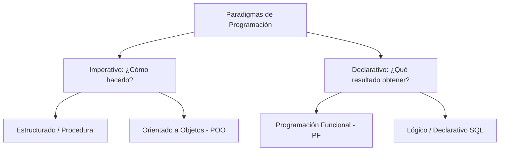

# Unidad I: Fundamentos del Paradigma de Programación Funcional
## Contenido de Estudio - Semana 1

---

## 1.1 Introducción a la Programación Funcional

### 1.1.1 ¿Qué es la Programación Funcional?
La **Programación Funcional (PF)** es un paradigma de programación **declarativo** enfocado en el "qué hacer" en lugar del "cómo hacerlo paso a paso". Se basa en la evaluación de **funciones matemáticas puras** y evita el cambio de estado global y la mutación de datos.

En un lenguaje con soporte funcional como Python:
- Las funciones son **ciudadanos de primera clase** (*First-Class Citizens*): pueden asignarse a variables, pasarse como argumentos y retornarse desde otras funciones.
- Se prioriza la **inmutabilidad**: una vez creado un dato, no se modifica; en su lugar, se generan nuevas versiones transformadas.
- Se busca la **transparencia referencial**: una función llamada con los mismos argumentos siempre devolverá exactamente el mismo resultado, sin alterar el entorno exterior.

---

### 1.1.2 Paradigma de Programación: Imperativo vs Declarativo



- **Imperativo (Estructurado / POO)**: Se enfoca en instrucciones secuenciales, bucles (`for`, `while`), control explícito del flujo y variables que mutan con el tiempo para reflejar el estado actual del sistema.
- **Declarativo (Funcional)**: Se enfoca en la composición de expresiones matemáticas y transformaciones de datos encadenadas, minimizando efectos secundarios.

---

### 1.1.4 Funciones Matemáticas y Transparencia Referencial
En matemáticas, una función $f(x) = x^2 + 1$ tiene dos características fundamentales:
1. **Determinismo**: Para $x = 3$, $f(3)$ siempre será $10$, sin importar cuántas veces se invoque o la hora del día.
2. **Sin efectos secundarios (*No Side-Effects*)**: Calcular $f(3)$ no altera ninguna variable externa, no imprime en consola ni modifica archivos en disco.

En programación funcional, a esto se le llama **Función Pura**:
```python
# ❌ Función IMPURA (Depende de estado externo y causa efectos secundarios)
total = 0
def acumular_impuro(valor):
    global total
    total += valor
    return total

# ✅ Función PURA (Determinista, sin efectos secundarios, transparente referencialmente)
def acumular_puro(total_actual, valor):
    return total_actual + valor
```

---

### 1.1.5 Cambios de Estado y Efectos Secundarios

Un **efecto secundario** ocurre cuando una función modifica algo fuera de su propio ámbito local (modificar una lista pasada por referencia, reescribir una variable global, escribir en disco, emitir salidas por red).

#### Mutabilidad vs Inmutabilidad en Python:
| Tipo de Dato | Mutabilidad | Comportamiento en PF |
| :--- | :---: | :--- |
| `int`, `float`, `bool`, `str` | **Inmutable** | Seguro por diseño. |
| `tuple`, `frozenset` | **Inmutable** | Colecciones ideales para estructuras de datos funcionales. |
| `list`, `dict`, `set` | **Mutable** | Deben tratarse con precaución para evitar mutaciones directas (`append`, `pop`, `del`). |

---

### 1.1.6 POO vs Programación Funcional

| Criterio | Programación Orientada a Objetos (POO) | Programación Funcional (PF) |
| :--- | :--- | :--- |
| **Unidad básica** | Clases y Objetos (Estado + Comportamiento juntos). | Funciones y Datos (Separados deliberadamente). |
| **Estado** | Estado mutable encapsulado en atributos del objeto (`self.variable`). | Datos inmutables que fluyen a través de tuberías de funciones. |
| **Control de flujo** | Bucles (`for`, `while`), métodos modificadores de estado. | Recursión, transformaciones (`map`, `filter`), comprensiones. |
| **Efectos secundarios** | Frecuentes y esperados mediante llamadas a métodos. | Aislados y minimizados al máximo. |
| **Concurrencia** | Compleja debido a condiciones de carrera por estado compartido. | Altamente segura y predecible al no existir estado mutable compartido. |

---

## 1.2 Comparación de Paradigmas con Python

Supongamos que tenemos una lista de puntajes de estudiantes y queremos **filtrar los aprobados ($\ge 70$), bonificarlos con 5 puntos y calcular el promedio final**.

### 1.2.1 Enfoque Estructurado (Imperativo)
```python
calificaciones = [65, 80, 92, 55, 74, 88]

aprobados_bonificados = []
for calif in calificaciones:
    if calif >= 70:
        aprobados_bonificados.append(calif + 5)

suma = 0
for calif in aprobados_bonificados:
    suma += calif

promedio = suma / len(aprobados_bonificados) if aprobados_bonificados else 0
print(f"Estructurado -> Promedio: {promedio}")
```

### 1.2.2 Enfoque Orientado a Objetos (POO)
```python
class GestorCalificaciones:
    def __init__(self, lista_calificaciones):
        self.calificaciones = list(lista_calificaciones)

    def filtrar_y_bonificar(self, umbral=70, bono=5):
        self.calificaciones = [c + bono for c in self.calificaciones if c >= umbral]
        return self

    def obtener_promedio(self):
        if not self.calificaciones:
            return 0.0
        return sum(self.calificaciones) / len(self.calificaciones)

gestor = GestorCalificaciones([65, 80, 92, 55, 74, 88])
promedio = gestor.filtrar_y_bonificar().obtener_promedio()
print(f"POO -> Promedio: {promedio}")
```

### 1.2.3 Enfoque Funcional (PF)
```python
# Transformación pura, sin alterar la lista original ni mantener estado en objetos
def bonificar_aprobados(calificaciones, umbral=70, bono=5):
    aprobados = tuple(c + bono for c in calificaciones if c >= umbral)
    return (sum(aprobados) / len(aprobados)) if aprobados else 0.0

calificaciones_originales = (65, 80, 92, 55, 74, 88)
promedio = bonificar_aprobados(calificaciones_originales)
print(f"Funcional -> Promedio: {promedio}")
```

---

## 1.3 Conceptos Clave de Python para PF

### 1.3.1 Expresiones Condicionales (Operador Ternario)
En PF se prefieren las expresiones (que devuelven un valor) sobre las sentencias (que ejecutan acciones):
```python
# Sintaxis: [valor_si_verdadero] if [condicion] else [valor_si_falso]
clasificar_nivel = lambda puntaje: "Avanzado" if puntaje >= 90 else ("Intermedio" if puntaje >= 70 else "Básico")
```

### 1.3.2 *Structural Pattern Matching* (`match / case`)
Introducido en Python 3.10, permite desempaquetar y evaluar patrones estructurales de forma limpia y declarativa:

```python
def evaluar_comando_conversacional(evento: tuple):
    match evento:
        case ("INICIAR", rol, nivel):
            return f"Iniciando simulación con rol '{rol}' para nivel '{nivel}'."
        case ("TURNO_USUARIO", texto) if len(texto.strip()) > 0:
            return f"Procesando respuesta del estudiante: {texto}"
        case ("FINALIZAR", razon):
            return f"Sesión concluida por motivo: {razon}"
        case _:
            return "Evento no reconocido o formato inválido."
```

---

## 1.4 Conexión con el Proyecto Hi Learning

En el proyecto [`proyecto.md`](file:///c:/Users/fanyf/OneDrive/Documentos/proyecto/proyecto.md), la programación funcional nos permite:
1. **Modelar los turnos de conversación como tuplas inmutables**: `(turno_id, emisor, texto, timestamp)`.
2. **Generar el reporte de feedback sin mutar el historial**: transformando la secuencia de mensajes mediante funciones puras de análisis.
3. **Controlar los estados de la micro-sesión (5 min)** mediante pattern matching declarativo.
